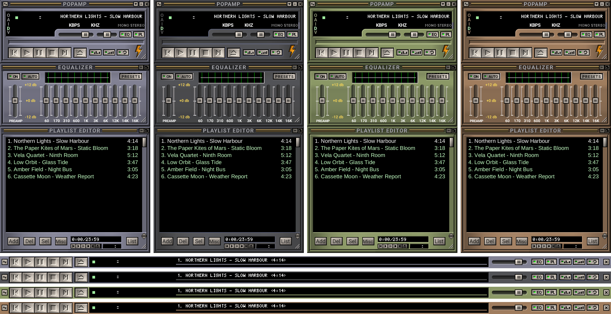

# Popamp Classified

# ⚠️ This skin was generated automatically

## It needs a designer's edits to make it simpler

The pictures were written by a program, not drawn by a designer, so the
files are more complicated than the skin needs. Fork it and redraw it.

Grey brushed metal, cream buttons, green lamps and gold rules: the classic 2004 skin "Classified" redrawn as vector sheets, with the original player's name and logo replaced by Popamp's.



A vector skin for [Popamp](https://github.com/popamp/popamp), skin format
version 1. It is only a port of an existing design; see
[Credits](#credits).

## Window or bar

The main window has a second view: a bar across the screen, at its top or
bottom edge, put together from the same pictures. Switch between the two
in the main menu's "Toolbar mode". This needs Popamp 1.0.0 or newer.

## Colours

The skin comes in four colours: Silver (the theme as it is), Graphite,
Olive and Bronze. Pick one in the main menu's "Colours". This needs Popamp
1.0.0 or newer. A colour changes only the metal; the cream buttons, gold
rules, green lamps and the display stay as they are.

## Media library

The media library window has the playlist's frame, its buttons and its
title bar, with its own "MEDIA LIBRARY" title and a "Menu" button in the
playlist's lettering. This needs Popamp 1.0.0 or newer.

## Install

With Popamp 1.0.0 or newer from [apt.popamp.app](https://apt.popamp.app):

```sh
sudo apt install popamp-skin-classified
```

Then pick it in the main menu's skin list. Or clone it into Popamp's
skins folder, where a copy of the same name wins over the package:

```sh
git clone https://github.com/popamp/skin-classified ~/.local/share/popamp/skins/classified
```

Updating is `git pull` in that folder; Popamp reloads the skin.

## Rebuild

Everything in `sheets/`, `bar/`, `ml/` and `skin.toml` is generated by one script, from
the colours and pixel markings stored in `tools/fits.json`. It needs
`python3-fonttools` and `fonts-roboto-unhinted`:

```sh
python3 -I -B tools/gen_classified_skin.py .
```

`--psz path/to/Classified.psz` also packs a single file. To measure the
colours again on the reference skin (needs `python3-numpy` and
`python3-pil`), add `--ref path/to/reference.wsz`.

Change the scripts, not the generated files.

## How it is drawn

- Every window is a handful of whole shapes: a metal panel or title strip
  is one rectangle under one gradient, bevels are single rings and lines.
- Buttons, lamps, icons, slots, the display's cut-out and Popamp's bolt are
  vector shapes in their own right.
- Titles and labels are letters of Roboto converted to outlines, so they
  scale with the window and no font is needed to show them.
- Only the bitmap fonts of the display (`text`, `numbers`, `nums_ex`,
  `monoster`, `playpaus`) stay exact, each colour as one outlined shape.

## Credits

This skin is a vector port of "Classified" (released July 4, 2004). The
design is not ours:

> Original Design by Steve Gedikian.
> Classic Version by John Slegers and PeterPan.
> Edited by Wildrose-Wally.
>
> Copyright © 2004-2007 Steve Gedikian, John Slegers, PeterPan &
> Wildrose-Wally. All rights reserved.

We could not find a way to contact the authors. If you are one of them
and want this port changed or removed, please open an issue.

## License

The scripts in `tools/` (`*.py`) are licensed under either of
[Apache License 2.0](LICENSE-APACHE) or [MIT license](LICENSE-MIT) at your
option. These licenses do not cover the artwork (`sheets/`,
`tools/fits.json`, `preview.png`): its design belongs to the authors
named above. The window titles are outlines of Roboto (Copyright 2011 Google Inc.,
Apache License 2.0).
